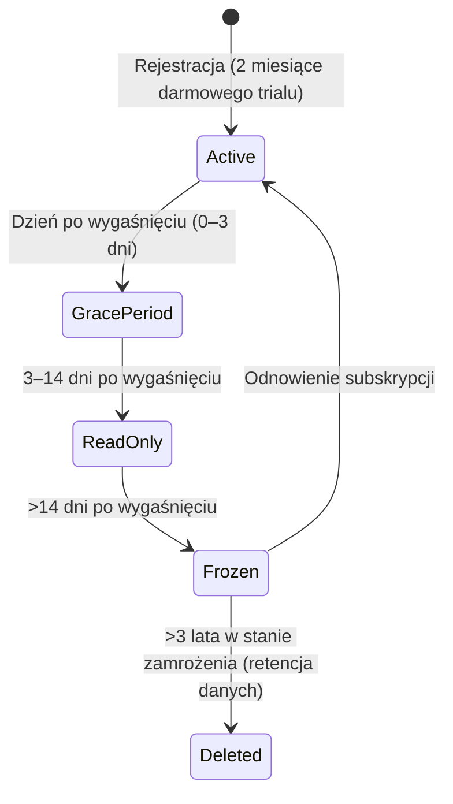

# 🔐 Accounts Module (`accounts/`)

Moduł odpowiada za zarządzanie tożsamością użytkowników, uwierzytelnianie, profil hodowcy oraz zaawansowaną logikę statusów subskrypcyjnych.

---

## 📌 Główne Odpowiedzialności

- **Niestandardowy model użytkownika (`Breeder`)**: Zastępuje domyślny model Django (`AUTH_USER_MODEL = "accounts.Breeder"`).
- **Logowanie oparte wyłącznie na e-mailu**: Usunięto pole `username`, unikalny `email` jest głównym identyfikatorem (`USERNAME_FIELD`).
- **Ochrona antybotowa**: Integracja z **Cloudflare Turnstile** przy logowaniu i rejestracji (`accounts/utils.py:verify_turnstile()`).
- **Zarządzanie stanem i cyklem konta**: Automatyczne wyliczanie statusu konta na podstawie ważności subskrypcji.
- **Profil hodowli**: Przechowywanie danych przydomka hodowlanego, oddziału ZKwP, numeru członkowskiego, NIP i logotypu.

---

## 🏗️ Model Danych: `Breeder`

Rozszerza `AbstractUser`, dodając pola dedykowane dla hodowców ZKwP:

| Pole | Typ | Opis |
|------|-----|------|
| `id` | `UUIDField` | Klucz główny UUIDv4 (brak przewidywalnych identyfikatorów sekwencyjnych) |
| `email` | `EmailField` (Unique) | Identyfikator logowania |
| `kennel_name` | `CharField(80)` | Przydomek hodowlany zarejestrowany w FCI/ZKwP |
| `branch` | `CharField(80)` | Oddział macierzysty ZKwP (np. Warszawa, Poznań) |
| `membership_number` | `CharField(30)` | Numer legitymacji członkowskiej ZKwP |
| `kennel_registration_number` | `CharField(50)` | Numer rejestracji przydomka |
| `subscription_valid_until` | `DateTimeField` | Data wygaśnięcia dostępu do systemu |
| `subscription_activated_at` | `DateTimeField` | Data aktywacji obecnego cyklu (istotna przy wyliczaniu ciągłości) |
| `current_plan` | `ForeignKey(SubscriptionPlan)` | Przypisany plan subskrypcyjny |
| `mfa_verification` | `BooleanField` | Flaga gotowości pod weryfikację dwuetapową |
| `stripe_customer_id` | `CharField(100)` | Identyfikator klienta w systemie Stripe |
| `stripe_subscription_id` | `CharField(100)` | Identyfikator aktywnej subskrypcji w Stripe |

---

## ⏱️ Cykl Życia Konta & Statusy Subskrypcji

Właściwości konta są wyliczane dynamicznie (nie są trwale zduplikowane w bazie), co gwarantuje spójność:

- **`active`** (`now <= subscription_valid_until`): Pełny dostęp do edycji, dodawania psów i miotów.
- **`grace_period`** (0–3 dni po terminie): Ostrzeżenie o konieczności opłacenia, dostęp nadal aktywny.
- **`read_only`** (3–14 dni): Możliwość przeglądania i eksportu danych, blokada tworzenia nowych rekordów.
- **`frozen`** (>14 dni): Dostęp zablokowany, archiwum czeka na wznowienie przez 3 lata.

### Reguła Ciągłości Subskrypcji (`is_continuity_broken`)
Jeśli subskrypcja wygasła na dłużej niż 7 dni, ciągłość zostaje przerwana:
- **Ciągłość zachowana (≤ 7 dni)**: Nowy okres dolicza się do dotychczasowej daty ważności.
- **Ciągłość przerwana (> 7 dni)**: Nowy okres zaczyna się od chwili opłacenia, a licznik stażu resetuje się.

---

## 🛡️ Bezpieczeństwo i Sesje

- **Kontrola sesji ("Zapamiętaj mnie")**: Przy logowaniu użytkownik decyduje o czasie trwania sesji:
  - Zaznaczona: plik cookie ważny przez 30 dni (`request.session.set_expiry(2592000)`).
  - Niezaznaczona: sesja wygasa po zamknięciu przeglądarki (`set_expiry(0)`).
- **Turnstile CAPTCHA**: Ochrona formularzy `/login/` i `/register/` przed atakami brute-force i credential stuffing.

---

## 🔗 Nawigacja
- ⬅️ [Wróć do głównego README](../README.md)
- 🐶 [Przejdź do modułu Hodowli (`kennel/`)](../kennel/README.md)
- 💳 [Przejdź do modułu Płatności (`billing/`)](../billing/README.md)
