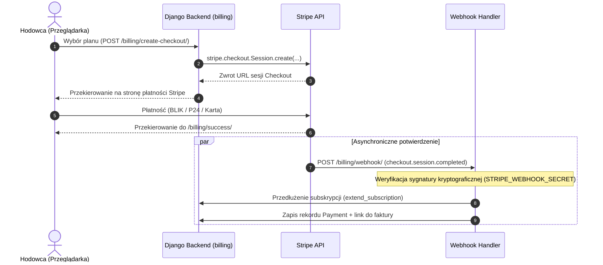

# 💳 Billing & Subscriptions Module (`billing/`)

Moduł odpowiada za monetyzację platformy **Przydomek.pl** w modelu SaaS, obsługę subskrypcji i doładowań za pośrednictwem integracji z **API Stripe** oraz automatyczne fakturowanie.

---

## 📌 Główne Funkcjonalności

- **Taryfikacja SaaS (`SubscriptionPlan`)**: Plany abonamentowe (Start, Pro, VIP) w cyklach miesięcznych i rocznych.
- **Stripe Checkout Sessions**: Nowoczesny, bezpieczny proces płatności hostowany przez Stripe z obsługą specyfiki polskiego rynku:
  - 💳 Karty płatnicze (Visa, Mastercard)
  - 📱 **BLIK** (płatność kodem z aplikacji bankowej)
  - 🏦 **Przelewy24** (szybkie przelewy z większości polskich banków)
- **Webhooks Stripe (`checkout.session.completed`)**: Bezpieczna asynchroniczna aktywacja i przedłużanie abonamentu po autoryzacji wpłaty.
- **Stripe Customer Portal**: Samoobsługowy panel dla użytkowników z subskrypcją cykliczną (zarządzanie kartami, zmiana planu, pobieranie faktur).
- **Archiwum Transakcji i Faktur (`Payment`)**: Zapisywanie historii wpłat wraz z bezpośrednimi odnośnikami do faktur Stripe (`hosted_invoice_url`).

---

## 🔄 Architektura Przepływu Płatności



---

## 📦 Modele Danych

### 1. `SubscriptionPlan`
Konfiguracja limitów i cen dla poszczególnych poziomów subskrypcji:
- `name` – nazwa planu (Start, Pro, VIP)
- `price` – cena w PLN
- `interval` – interwał (`monthly` / `yearly`)
- `max_breeding_dogs` – maksymalna liczba aktywnych psów hodowlanych
- `max_litters_per_year` – maksymalny roczny limit miotów
- `storage_gb` – przydzielone miejsce na skany dokumentów i zdjęcia
- `pit_access_monthly_threshold` – wymagany staż miesięcy dla planów miesięcznych do odblokowania generatora deklaracji podatkowych PiT-6

### 2. `Payment`
Trwały zapis wykonanej płatności powiązany z modelem `Breeder` oraz `SubscriptionPlan`:
- Obie relacje zabezpieczone są regułą `on_delete=models.PROTECT`, co uniemożliwia przypadkowe usunięcie użytkownika lub planu, do którego przypisane są historyczne dane księgowe.
- `stripe_checkout_session_id` – identyfikator sesji transakcyjnej w Stripe.
- `invoice_url` – link do wygenerowanej przez Stripe faktury w formacie PDF/HTML.

---

## 🛡️ Bezpieczeństwo Płatności

1. **Weryfikacja Podpisu Webhooka**:
   Każde żądanie z serwerów Stripe jest kryptograficznie weryfikowane za pomocą `STRIPE_WEBHOOK_SECRET`:
   ```python
   event = stripe.Webhook.construct_event(payload, sig_header, settings.STRIPE_WEBHOOK_SECRET)
   ```
   Zapobiega to próbom podrobienia potwierdzenia płatności.
2. **Brak Danych Kart w Aplikacji**:
   Ani numer karty, ani kod CVC nigdy nie trafiają na serwer aplikacji. Całość transakcji odbywa się w certyfikowanym środowisku Stripe (zgodnym z normą **PCI-DSS Level 1**).
3. **Idempotentność i Mapowanie Price ID**:
   Plany w sesji Stripe są powiązane przez `metadata={'price_id': ...}`, co gwarantuje jednoznaczność przypisania planu nawet w przypadku równoległych żądań.

---

## 🔗 Nawigacja
- ⬅️ [Wróć do głównego README](../README.md)
- 🔐 [Przejdź do modułu Kont (`accounts/`)](../accounts/README.md)
- 🐶 [Przejdź do modułu Hodowli (`kennel/`)](../kennel/README.md)
