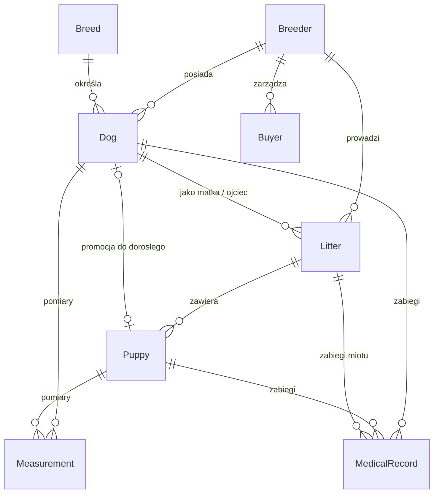

# 🐶 Kennel Module (`kennel/`)

Główny moduł domeny biznesowej aplikacji **Przydomek.pl**. Odpowiada za ewidencję stada, planowanie i obsługę miotów, rozwój szczeniąt, rejestrację danych medycznych, dokumentacji oraz poufnych danych nabywców.

---

## 📌 Główne Funkcjonalności

- **Ewidencja Psów Dorosłych (`Dog`)**: Pełna historia psa (imię z przydomkiem, rasa, PKR, numer rejestracji oddziałowej, chip, tatuaż, status hodowlany, współwłasność).
- **Zarządzanie Miotami (`Litter`)**: Śledzenie etapów miotu (planowany, krycie, narodziny, zgłoszony, przegląd, zarchiwizowany) z automatyczną walidacją rodziców.
- **Wzorzec Promocji Szczenięcia (`Puppy` ➡️ `Dog`)**: Szczenię, które zostaje w hodowli, może zostać bezpośrednio przekształcone w dorosłego psa z zachowaniem powiązania `OneToOneField`.
- **Dziennik Biometrii i Pomiary (`Measurement`)**: Pomiary wagi, wysokości w kłębie, obwodu klatki/głowy, temperatury i oceny kondycji BCS (Body Condition Score 1–9) ze zdjęciami.
- **Elektroniczna Dokumentacja i Kartoteka Medyczna (`DocumentRecord`, `MedicalRecord`)**: Polimorficzne przypisywanie wpisów do psa, szczenięcia lub całego miotu.
- **Szyfrowana Kartoteka Nabywców (`Buyer`)**: Magazyn danych osobowych przyszłych właścicieli z kryptograficzną ochroną numeru PESEL/dokumentu tożsamości.

---

## 🏛️ Architektura Modeli i Relacji



---

## 🧩 Kluczowe Wzorce Projektowe

### 1. Wzorzec Promocji Szczenięcia (`Puppy Promotion`)
Gdy hodowca decyduje się zostawić szczenię w hodowli jako przyszłego reproduktora lub sukę hodowlaną:
- Tworzony jest profil `Dog` powiązany relacją `Puppy.adult_dog_profile = models.OneToOneField(Dog, ...)`.
- Pola tożsamości (chip, tatuaż, płeć, imię) zostają zablokowane do edycji z poziomu szczenięcia, aby uniknąć anomalii spójności.
- Usunięcie psa dorosłego pozwala przywrócić pierwotny stan szczenięcia.

### 2. Obsługa Reproduktorów Zewnętrznych (`External Parent Snapshot`)
W hodowli psów rasowych krycie często odbywa się psem z innej hodowli (krajowej lub zagranicznej):
- Jeśli reproduktor należy do hodowcy: relacja `Litter.father = models.ForeignKey(Dog)`.
- Jeśli reproduktor jest zewnętrzny: dane wprowadzane są do `Litter.father_data_snapshot` (`JSONField`).
- **Integralność biznesowa**: Metoda `clean()` modelu `Litter` rygorystycznie wymusza, by jednoznacznie istniał albo klucz obcy, albo snapshot – nigdy oba jednocześnie.

### 3. Polimorficzne Rekordy Medyczne i Dokumentowe
Modele `MedicalRecord`, `DocumentRecord` oraz `Measurement` mogą dotyczyć pojedynczego psa, szczenięcia lub całego miotu (np. odrobaczenie miotu):
- Każdy model posiada klucze `dog`, `puppy`, `litter` z `null=True`.
- Spójność wymuszana jest na poziomie bazy danych constraintem `CheckConstraint`:
  ```python
  models.CheckConstraint(
      condition=(
          models.Q(dog__isnull=False, puppy__isnull=True, litter__isnull=True)
          | models.Q(dog__isnull=True, puppy__isnull=False, litter__isnull=True)
          | models.Q(dog__isnull=True, puppy__isnull=True, litter__isnull=False)
      ),
      name="medical_record_one_animal_source",
  )
  ```

### 4. Szyfrowanie Danych Osobowych Nabywców (PII Security)
W modelu `Buyer`, pole identyfikatora tożsamości (PESEL / numer dowodu osobistego) jest chronione za pomocą algorytmu **Fernet (AES-128-CBC + HMAC-SHA256)**:
```python
id_number = encrypted_fields.EncryptedCharField(max_length=25)
```
W bazie danych PostgreSQL przechowywany jest wyłącznie nieczytelny szyfrogram. Nawet bezpośredni wyciek zrzutu bazy (dump.sql) nie ujawni wrażliwych danych nabywców.

---

## 🔒 Reguła Izolacji Danych (Multi-Tenancy)

Każdy widok w `kennel/views.py` rygorystycznie ogranicza zapytania do zalogowanego użytkownika:
```python
# Przykład bezpiecznego pobierania obiektu
dog = get_object_or_404(Dog, pk=pk, breeder=request.user)
```
Próba dostępu do danych innego hodowcy zwraca błąd `404 Not Found` (nie ujawniając nawet istnienia danego rekordu).

---

## 🔗 Nawigacja
- ⬅️ [Wróć do głównego README](../README.md)
- 🔐 [Przejdź do modułu Kont (`accounts/`)](../accounts/README.md)
- 💳 [Przejdź do modułu Płatności (`billing/`)](../billing/README.md)
